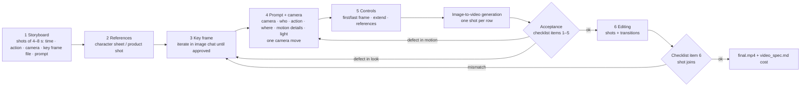

# L05: Lesson Graph (deck v2, 21 slides, 90 min)

Updated 2026-10-12 for the 21-slide deck (storyboard, access layers and cost table added; pipeline is 6 steps).
Single map of how the lesson is built: what each slide teaches, what it depends on, and which artifact carries it into practice.
Source of truth for slide content: `deck_v2/build.py`. Facts: `L05_08_Source_Notes_Research_2026-10.md`.

## 1. Concept flow (slides)

```mermaid
flowchart LR
  subgraph PREV[Prerequisites]
    L03[L03: API call, async thinking]
    L04[L04: image generation, edit model, courier key frames, character sheet]
  end

  subgraph P1[Part 1: basics and the 6-step pipeline · 00:00–58:00]
    S01[01 Cover]
    S02[02 Example: 23 s video<br/>3 shots · 8+8+8 · ≈$10]
    S03[03 Where to generate<br/>chat · web studio · API]
    S04[04 How diffusion makes frames<br/>noise → denoise → frames<br/>no physics engine]
    S05[05 Anti-pattern<br/>text-to-video, story in one prompt]
    S06[06 Text-to-video vs image-to-video<br/>frame first, motion second]
    S07[07 Step 1: storyboard<br/>shots of 4–8 s · 1 row = 1 key frame + 1 prompt]
    S08[08 Step 2: references<br/>character sheet]
    S09[09 Step 3: key frame<br/>seconds·cents vs minutes·$0.40/s]
    S10[10 Step 4: prompt<br/>6 slots]
    S11[11 Step 4: camera<br/>8 moves, one per shot]
    S12[12 Step 5: controls<br/>first/last frame · extend · refs · brush]
    S13[13 Step 6: editing<br/>8+8+8−0.5−0.5 = 23 s]
    S14[14 Market, Oct 2026<br/>clip length + capabilities]
  end

  BRK[15 Break · 5 min]

  subgraph P2[Part 2: code, cost, acceptance, risk · 63:00–90:00]
    S16[16 Code for reference<br/>google-genai: submit → poll → download]
    S17[17 Cost<br/>clip · minute · hour · 3 attempts<br/>1 h = 450 shots]
    S18[18 Acceptance checklist<br/>6 items = homework rubric]
    S19[19 Risks<br/>SynthID vs C2PA · EU AI Act Art. 50]
    S20[20 Homework<br/>three-shot mini story]
    S21[21 Five rules + L06 note]
  end

  L06[L06: speech & audio]

  L04 --> S06
  L04 --> S08
  L04 --> S09
  L03 --> S16
  S01 --> S02 --> S03 --> S04 --> S05 --> S06
  S04 -. explains .-> S05
  S05 -. motivates .-> S06
  S05 -. one scene per shot .-> S07
  S06 --> S07 --> S08 --> S09 --> S10 --> S11 --> S12 --> S13 --> S14
  S02 -. same video, decomposed .-> S13
  S07 -. timing and overlaps .-> S13
  S14 --> BRK --> S16 --> S17 --> S18 --> S19 --> S20 --> S21
  S03 -. billing per layer .-> S17
  S07 -. shots per minute / hour .-> S17
  S09 -. price per second .-> S17
  S05 -. defect types .-> S18
  S18 -. rubric .-> S20
  S07 -. storyboard.md .-> S20
  S21 --> L06
```

## 2. Pipeline the students reproduce (6 steps)



## 3. Slide → artifact coverage

| Slide | Script (RU/EN) | Cheatsheet | Notebook | Demo runbook | Homework |
|---|---|---|---|---|---|
| 02 Example video | ✓ | ✓ | n/a | `courier_delivery_final.mp4` | n/a |
| 03 Access layers | ✓ | ✓ | n/a | platform list | services table |
| 04 How diffusion makes frames | ✓ | ✓ | Step 3 “what can go wrong” | n/a | n/a |
| 05 Text-to-video anti-pattern | ✓ | ✓ | n/a | Block 2.1, `trainwreck_naive_t2v.mp4` | text-to-video baseline |
| 06 Text-to-video vs image-to-video | ✓ | ✓ | text-to-video / image-to-video cells | Blocks 2, 4 | baseline vs shots comparison |
| 07 Step 1: storyboard | ✓ | ✓ | n/a | Block 10 (7-column matrix) | `storyboard.md` |
| 08–09 Steps 2–3: references, key frame | ✓ | ✓ | `image=` input | Block 4 | key frames from L04 |
| 10–11 Step 4: prompt, camera | ✓ | ✓ | 6-slot table + prompt (old slide 8 reference, now slide 10) | Blocks 2.2, 3, 4 | prompts in `storyboard.md`, `video_spec.md` |
| 12 Step 5: controls | ✓ | ✓ | n/a | Blocks 5–6 | optional |
| 13 Step 6: editing | ✓ | ✓ | n/a | ffmpeg one-liner | `final.mp4` |
| 14 Market | ✓ | ✓ | Omni note in Step 3 | n/a | services table |
| 16 Code | ✓ | ✓ | ✓ (`RUN_PAID=False`) | Block 9 | optional (Veo via API) |
| 17 Cost | ✓ | ✓ | cost estimate | Block 10.4 (Kling credits) | cost table in `video_spec.md` |
| 18 Acceptance | ✓ | ✓ | n/a | ✓ | `video_qa.md` rubric (items 1–6) |
| 19 Risks | ✓ | ✓ | n/a | Block 10.4 (labelling) | no logos, consent rule |
| 20 Homework | ✓ | ✓ | n/a | Block 7 (Track A) | `L05_05_Homework*.md` |
| 21 Five rules + L06 | ✓ | ✓ | n/a | n/a | n/a |

## 4. Volatile facts to recheck 24 h before class

Gemini Omni model ID and limits · Veo 3.1 IDs (preview vs GA), $/s and Lite limits (no extend, no references, no 4K) · Grok Imagine 1.5 / Lite API prices · Runway API prices (Gen-4.5, Seedance 2.5) · Kling credits per second · Kling 4.0 Flash (≤20 s, early access) vs full 4.0 (≤30 s, announced for Oct) · Seedance/Wan/Hailuo clip lengths · LMArena / Artificial Analysis leaders · Sora 2 shutdown dates (API 24.09 primary-sourced; app 26.04 secondary only) · free allowances per service (homework table; Kling: small monthly grant for free accounts) · EU AI Act Art. 50 dates and fines.
