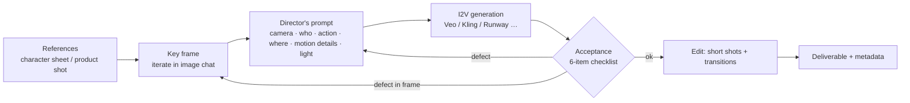

# L05 — Lesson Graph (deck v2, 19 slides, 90 min)

Single map of how the lesson is built: what each slide teaches, what it depends on, and which artifact carries it into practice.
Source of truth for slide content: `deck_v2/build.py`. Facts: `L05_08_Source_Notes_Research_2026-10.md`.

## 1. Concept flow (slides)

```mermaid
flowchart LR
  subgraph PREV[Prerequisites]
    L03[L03: API call, async thinking]
    L04[L04: image generation, edit model, courier key frames]
  end

  subgraph P1[Part 1 — build a clip step by step · 00:00–51:00]
    S01[01 Cover]
    S02[02 Hook: finished 23 s clip<br/>3 shots · 8+8+8 · ≈$10]
    S03[03 How a model makes video<br/>noise → denoise → frames<br/>no physics engine]
    S04[04 Failure gallery<br/>T2V in one prompt]
    S05[05 T2V vs I2V<br/>frame first, motion second]
    S06[06 Step 1: references<br/>character sheet]
    S07[07 Step 2: key frame in chat<br/>seconds·cents vs minutes·$0.40/s]
    S08[08 Step 3: director's prompt<br/>6 motion slots]
    S09[09 Camera language<br/>8 moves]
    S10[10 Step 4: local control<br/>first/last frame · extend · refs · brush]
    S11[11 Step 5: editing<br/>8+8+8−0.5−0.5 = 23 s]
  end

  BRK[12 Break · 5 min]

  subgraph P2[Part 2 — market, money, acceptance, risk · 56:00–90:00]
    S13[13 Market, Oct 2026<br/>clip length + capabilities]
    S14[14 Code for reference<br/>google-genai Veo: submit → poll → download]
    S15[15 Economics<br/>$96 vs $28.80 vs $7.20]
    S16[16 Acceptance checklist<br/>6 items = homework rubric]
    S17[17 Risks & provenance<br/>SynthID vs C2PA · EU AI Act Art. 50]
    S18[18 Homework #5<br/>Track A product · Track B courier]
    S19[19 Four rules + L06 bridge]
  end

  L06[L06: speech & audio]

  L04 --> S05
  L04 --> S07
  L03 --> S14
  S01 --> S02 --> S03 --> S04 --> S05
  S03 -. explains .-> S04
  S04 -. motivates .-> S05
  S05 --> S06 --> S07 --> S08 --> S09 --> S10 --> S11
  S02 -. same clip, decomposed .-> S11
  S11 --> BRK --> S13 --> S14 --> S15 --> S16 --> S17 --> S18 --> S19
  S07 -. price per second .-> S15
  S04 -. defect types .-> S16
  S16 -. rubric .-> S18
  S19 --> L06
```

## 2. Pipeline the students reproduce (the "5 steps")

## 3. Slide → artifact coverage

| Slide | Script (RU/EN) | Cheatsheet | Notebook | Demo runbook | Homework |
|---|---|---|---|---|---|
| 02 Hook | ✓ | ✓ | — | `courier_delivery_final.mp4` | — |
| 04 Failure gallery | ✓ | ✓ | — | `trainwreck_naive_t2v.mp4` | Step 1 (T2V trap) |
| 05 T2V vs I2V | ✓ | ✓ | T2V/I2V cells | ✓ | Steps 1–2 |
| 06–07 References, key frame | ✓ | ✓ | `image=` input | ✓ | Step 2 (L04 frame) |
| 08–09 Prompt, camera | ✓ | ✓ | prompt cell | ✓ | `video_spec.md` |
| 10 Local control | ✓ | ✓ | — | — | optional |
| 11 Editing | ✓ | ✓ | — | ffmpeg one-liner | — |
| 14 Code | ✓ | ✓ | ✓ (`RUN_PAID=False`) | ✓ | — |
| 15 Economics | ✓ | ✓ | cost estimate | — | — |
| 16 Acceptance | ✓ | ✓ | — | ✓ | `video_qa.md` rubric |
| 17 Risks | ✓ | ✓ | — | — | consent rule |
| 18 Homework | ✓ | ✓ | — | — | `L05_05_Homework*.md` |

## 4. Volatile facts to recheck 24 h before class

Gemini Omni model ID and limits · Veo 3.1 IDs (preview vs GA) and $/s · Kling 3.0/4.0 status · Seedance/Wan/Hailuo clip lengths · LMArena / Artificial Analysis leaders · Sora 2 shutdown dates · EU AI Act Art. 50 dates and fines.
