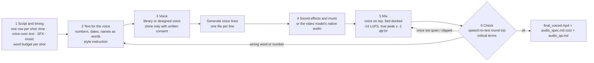

# L06: Lesson Graph (deck v2, 21 slides, 90 min)

Created 2026-10-12. Single map of how the lesson is built: what each slide teaches, what it depends on, and which artifact carries it into practice.
Source of truth for slide content: `deck_v2/build.py`. Facts: `L06_08_Source_Notes_Research_2026-10.md`. Real audio for the slides: `deck_v2/make_audio.py` → `demo_courier_audio/report.json`.

**Through-line case:** the 23-second courier video from L05 (three Veo 3.1 shots) gets a voice-over, a sound bed and a music bed, is mixed to a streaming loudness target and checked by speech-to-text. The same pipeline is the homework.

## 1. Concept flow (slides)

```mermaid
flowchart LR
  subgraph PREV[Prerequisites]
    L03[L03: API call, google-genai]
    L04[L04: images, courier character]
    L05[L05: 23 s courier video, storyboard with voice-over / SFX / music columns, native audio in video models]
  end

  subgraph P1[Part 1: tasks, models and the 6-step pipeline · 00:00–58:00]
    S01[01 Cover]
    S02[02 Example: the L05 video with voice-over<br/>3 lines · 3 stems · -14 LUFS]
    S03[03 Where to generate<br/>chat · web studio · API · open weights]
    S04[04 Four audio tasks<br/>TTS · STT · speech-to-speech · music and SFX]
    S05[05 How audio models work<br/>waveform → audio tokens → waveform]
    S06[06 Sound inside video models<br/>Veo native audio: what it gives, what it cannot]
    S07[07 Step 1: script and timing<br/>words per second per shot]
    S08[08 Step 2: text for the voice<br/>numbers as words, style instructions]
    S09[09 Step 3: voice<br/>library · designed · cloned with consent]
    S10[10 Step 4: sound effects and music<br/>prompt, length, licence]
    S11[11 Step 5: mix<br/>ducking · -14 LUFS · -1 dBTP]
    S12[12 Step 6: check with speech-to-text<br/>word error rate + critical terms]
    S13[13 Local open-weight models<br/>Hugging Face → disk → CPU/GPU · hardware · cost]
    S14[14 Market, Oct 2026]
  end

  BRK[15 Break · 5 min]

  subgraph P2[Part 2: code, cost, acceptance, risk · 63:00–90:00]
    S16[16 Coding agent installs Qwen3-TTS<br/>voice clone: sample + transcript + text]
    S17[17 Cost<br/>second · minute · hour of audio]
    S18[18 Acceptance checklist<br/>6 items = homework rubric]
    S19[19 Risks and voice consent]
    S20[20 Homework<br/>voice your L05 video]
    S21[21 Summary + L07]
  end

  L05 --> S02
  L05 --> S06
  L05 --> S07
  L03 --> S16
  S01 --> S02 --> S03 --> S04 --> S05 --> S06 --> S07 --> S08 --> S09 --> S10 --> S11 --> S12 --> S13 --> S14 --> BRK
  BRK --> S16 --> S17 --> S18 --> S19 --> S20 --> S21
  S06 -. exact words need a separate voice .-> S07
  S05 -. why numbers break .-> S08
  S09 -. consent .-> S19
  S03 -. fourth path .-> S13
  S13 -. hands-on .-> S16
  S09 -. clone needs consent .-> S16
  S03 -. billing per layer .-> S17
  S12 -. items 1–2 .-> S18
  S11 -. items 4–5 .-> S18
  S18 -. rubric .-> S20
  S07 -. script.md .-> S20
```

## 2. Pipeline the students reproduce (6 steps)



## 3. Slide → artifact coverage

| Slide | Script (RU/EN) | Cheatsheet | Demo assets | Homework |
|---|---|---|---|---|
| 02 Example | ✓ | ✓ | `assets/v2/video/courier_voiced_{en,ru}.mp4` | target result |
| 03 Where to generate | ✓ | ✓ | n/a | services table |
| 04 Four tasks | ✓ | ✓ | n/a | n/a |
| 05 How audio models work | ✓ | ✓ | `envelopes.json` (real waveform) | n/a |
| 06 Sound inside video models | ✓ | ✓ | `veo_native.mp3` | option: keep or replace the native audio |
| 07 Step 1: script and timing | ✓ | ✓ | `VO_LINES` in `make_audio.py` | `script.md` |
| 08 Step 2: text for the voice | ✓ | ✓ | display vs spoken text in `report.json` | spoken text column |
| 09 Step 3: voice | ✓ | ✓ | Kokoro `af_heart` (EN), Piper `dmitri` (RU) | two voice services |
| 10 Step 4: SFX and music | ✓ | ✓ | `music_bed.mp3` (MusicGen-small) | SFX or music, with licence |
| 11 Step 5: mix | ✓ | ✓ | `mix_{en,ru}.mp3`, loudness in `report.json` | `final_voiced.mp4`, loudness |
| 12 Step 6: check | ✓ | ✓ | Whisper transcripts, word error rate, critical terms | round-trip transcript |
| 13 Local models | ✓ | ✓ | `make_audio.py` (Kokoro, Piper, Whisper on CPU) | optional open-weight voice |
| 14 Market | ✓ | ✓ | n/a | services table |
| 16 Agent + local clone | ✓ | ✓ | `make_clone.py`, `clone_report.json` | optional: clone your own voice |
| 17 Cost | ✓ | ✓ | n/a | cost table in `audio_spec.md` |
| 18 Acceptance | ✓ | ✓ | `report.json` | `audio_qa.md` rubric (items 1–6) |
| 19 Risks | ✓ | ✓ | n/a | consent and licence rule |
| 20 Homework | ✓ | ✓ | n/a | `L06_05_Homework*.md` |

## 4. Volatile facts to recheck 24 h before class

See the list at the end of `L06_08_Source_Notes_Research_2026-10.md`.
