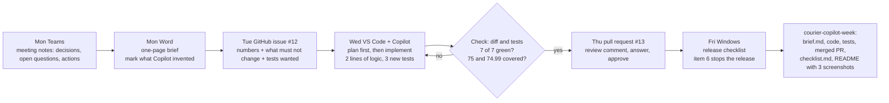

# L07: Lesson Graph (deck v2, 21 slides, 90 min)

Created 2026-10-13. Single map of how the lesson is built: what each slide teaches, what it depends on, and which artifact carries it into practice.
Source of truth for slide content: `deck_v2/build.py`. Facts: `L07_08_Source_Notes_Research_2026-10.md`. Real result for the slides: `deck_v2/make_artifacts.py` → `deck_v2/artifacts.json` (a real `git diff` and a real `python -m unittest -v` run of `demo_courier_copilot/sample_repo`).

**Through-line case:** a small product team of the courier app (Anna, Pavel, Ola) ships one feature in a week: Prime subscribers get free delivery from a $75 order inside the city zone. Copilot helps at every step in three places (repository, work documents, your PC). The same week is the homework.

## 1. Concept flow (slides)

```mermaid
flowchart LR
  subgraph PREV[Prerequisites]
    L03[L03: API call with Python, same kind of model, context in the request]
    L04[L04: courier character and case]
    L05[L05: courier video, cover frame]
    L06[L06: acceptance checklist habit, consent and rights]
  end

  subgraph P1[Part 1: three places, the week, the editor · 00:00–57:00]
    S01[01 Cover<br/>one Copilot? a family of three]
    S02[02 The week: six steps<br/>Teams · Word · issue · VS Code · PR · Windows]
    S03[03 Three places<br/>repository · work documents · your PC]
    S04[04 Same model as L03<br/>context = what it sees]
    S05[05 Teams<br/>meeting → decisions and tasks]
    S06[06 Word<br/>notes → one-page brief · demo A]
    S07[07 Outlook and Excel<br/>same button, other context]
    S08[08 Free vs paid<br/>the only slide with prices]
    S09[09 GitHub issue<br/>the brief becomes a task]
    S10[10 Editor<br/>completion · chat · agent · demo B]
    S11[11 Result<br/>2-line diff, 7 green tests]
    S12[12 Pull request<br/>Copilot review is not the judge]
    S13[13 copilot-instructions.md<br/>a README for the robot]
    S14[14 Four doors to GitHub Copilot<br/>editor · github.com · CLI · cloud agent]
  end

  BRK[15 Break · 5 min]

  subgraph P2[Part 2: Windows, acceptance, limits · 62:00–90:00]
    S16[16 Windows<br/>Copilot key · app · Vision]
    S17[17 Release day<br/>checklist as context · demo C]
    S18[18 Six checks<br/>= homework rubric]
    S19[19 Limits<br/>permissions · secrets · training on data]
    S20[20 Homework<br/>courier-copilot-week]
    S21[21 Summary + L08]
  end

  L03 --> S04
  L05 --> S01
  L06 --> S18
  L04 --> S02
  S01 --> S02 --> S03 --> S04 --> S05 --> S06 --> S07 --> S08 --> S09 --> S10 --> S11 --> S12 --> S13 --> S14 --> BRK
  BRK --> S16 --> S17 --> S18 --> S19 --> S20 --> S21
  S03 -. where does the information live .-> S16
  S04 -. file in the request .-> S17
  S06 -. mark what is invented .-> S18
  S09 -. numbers + not-to-change .-> S18
  S11 -. diff and tests .-> S18
  S12 -. review .-> S18
  S08 -. free tools only .-> S20
  S18 -. rubric .-> S20
  S19 -. training off .-> S20
  S07 -. Excel table .-> L08[L08: data analysis]
  S14 -. depth .-> L16[L16: agentic coding]
  S13 -. MCP and connectors .-> L12[L12: MCP]
```

## 2. The week the students reproduce (6 steps = 6 checks)

## 3. Slide → artifact coverage

| Slide | Script (RU/EN) | Cheatsheet | Demo assets | Homework |
|---|---|---|---|---|
| 01 Cover | ✓ | ✓ | L05 cover frame | n/a |
| 02 The week | ✓ | ✓ | strip of six real excerpts | the whole week |
| 03 Three places | ✓ | ✓ | n/a | three places = three tools |
| 04 Same model as L03 | ✓ | ✓ | L03 call snippet | n/a |
| 05 Teams | ✓ | ✓ | `meeting_notes.md` | notes input |
| 06 Word | ✓ | ✓ | `fallback_outputs/brief_expected.md` | `brief.md` (check 1) |
| 07 Outlook and Excel | ✓ | ✓ | invented 8-row table | n/a (L08 preview) |
| 08 Free vs paid | ✓ | ✓ | n/a | free tools only |
| 09 GitHub issue | ✓ | ✓ | `sample_repo/ISSUE.md` | issue link (check 2) |
| 10 Editor | ✓ | ✓ | `sample_repo/`, two prompts in the runbook | `delivery_fee.py` (check 3) |
| 11 Result | ✓ | ✓ | `artifacts.json` (real diff and test run) | tests (check 4) |
| 12 Pull request | ✓ | ✓ | `fallback_outputs/review_expected.md` | merged PR (check 5) |
| 13 copilot-instructions.md | ✓ | ✓ | `.github/copilot-instructions.md` | optional file |
| 14 Four doors | ✓ | ✓ | n/a | n/a |
| 16 Windows | ✓ | ✓ | `surface_preflight.md` | n/a |
| 17 Release day | ✓ | ✓ | `release_checklist.txt`, `fallback_outputs/checklist_answer.md` | `checklist.md` (check 6) |
| 18 Six checks | ✓ | ✓ | real values from `artifacts.json` | rubric (checks 1–6) |
| 19 Limits | ✓ | ✓ | n/a | privacy rules, training off |
| 20 Homework | ✓ | ✓ | `sample_repo/` as starter (without `expected_solution/`) | `L07_05_Homework*.md` |
| 21 Summary | ✓ | ✓ | n/a | n/a |

## 4. Dependencies

- **Needs:** L03 (the same API call; slide 4 says Copilot adds your file to it), L05 (cover frame, the courier case), L04–L06 (the case and the habit of an acceptance checklist).
- **Feeds:** L08 (the Excel table of slide 7 is the data of the next lesson), L12 (connectors and MCP: one line only), L16 (agents, the cloud agent, IDEs: slides 10 and 14 are the map).
- **Depth boundaries:** coding agents and IDEs → L16; MCP → L12; data analysis → L08; Claude → L09.

## 5. Volatile facts to recheck 24 h before class

See the list at the end of `L07_08_Source_Notes_Research_2026-10.md`. Prices and product names live on slide 8 only.
